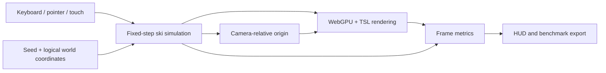

# Architecture

The prototype keeps world description, simulation, rendering, and instrumentation
independent. Rendering reads simulation state but never decides gameplay outcomes.

The browser frame loop accumulates real time and advances the authoritative
simulation in exact 1/60-second steps. A 200 ms accumulator cap prevents runaway
catch-up after a suspended tab. The renderer receives the current state and a
small, rebased coordinate for GPU-safe arithmetic.

Endless Mountain keeps the current and previous section descriptors. A
section's identity derives from its parent's hash and the lane crossed at the
fork. Length and lane choice are resolved in world coordinates. Entry center
and playable edges match at the seam and ease toward the selected trail.
Feature cells, authored ramp sequences, piste edges, gates, and avalanche
shelters come from the same descriptors used by simulation and rendering.

At a live section crossing, the game stores one skier, NPC, and replay cursor
checkpoint. Retrying restores that checkpoint and the committed gate total,
then replays new input from that point. Version 6 replay links include the seed,
initial section/scenario, relevant simulation options, and 60 Hz inputs.
World transitions are derived from those inputs. New links store recordings
in the URL fragment so long runs load without a lengthy request URL.
Version 5 links select the
classic continuous field. The mountain reports when its 16,000 input-run
recording buffer fills, while the descent itself continues.

The course uses bounded camera-local vertex buffers and a single small
transparent plane for the avalanche. Its wake is culled outside the camera
band. CPU feature instances and the ground remain on the existing adaptive
canvas and use local coordinates for rendering.
